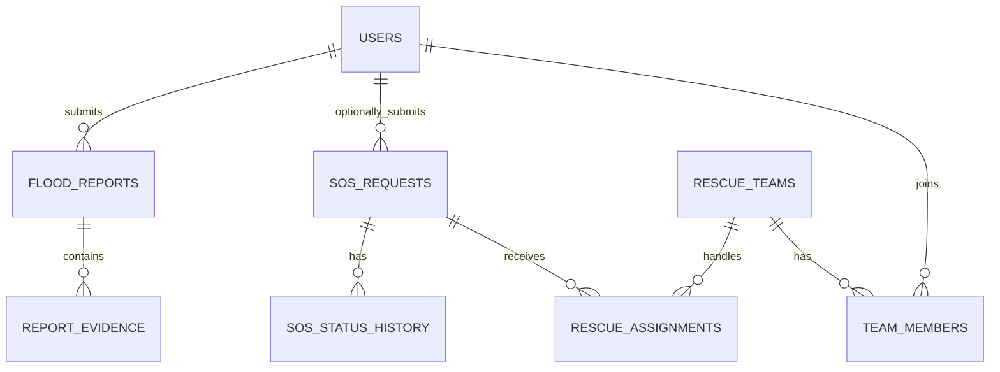

# Data model and PostGIS conventions

Use PostgreSQL 17/PostGIS 3.5 and TypeORM **explicit migrations**. DB uses `snake_case`, APIs `camelCase`. Prefer UUID keys, `timestamptz` and bounded text. Keep history, permissions and sensitive information separate from public queries.

## Core entities

| Table | Key fields | Relations/notes |
|---|---|---|
| `users` | id, name, email, password_hash, role, created_at | Staff accounts for MVP; no mandatory resident login |
| `flood_reports` | id, reporter_id nullable, location geography(Point,4326), severity, road_status, verification_status, description, observed_at, created_at | Anonymous report supported; public sanitized projection only |
| `report_evidence` | id, report_id, storage_key, media_type, created_at | Private media pointers, optional |
| `sos_requests` | id, requester_id nullable, tracking_token_hash, location, accuracy_m, assistance_type, people_count, priority, status, description, contact_encrypted, created_at, updated_at | Private only |
| `sos_status_history` | id, sos_id, changed_by nullable, old_status, new_status, reason, created_at | Append-only history |
| `rescue_teams` | id, name, status, base_location geography nullable, created_at | Team availability; base is not reliable live position |
| `team_members` | team_id, user_id | Composite PK |
| `rescue_assignments` | id, sos_id, team_id, status, assigned_at, completed_at | Transactional assignment lifecycle |
| `audit_logs` (required prior to pilot) | id, actor_id nullable, action, entity_type, entity_id, metadata_redacted jsonb, occurred_at | No tokens, raw private notes or contact data |
| `idempotency_records` (required before SOS) | id, scope, key_hash, request_hash, response_ref, status, created_at, expires_at | Atomic with SOS creation; avoid storing raw secret key |

## Relationships



## Spatial conventions

The foundation TypeORM migration ensures PostGIS and pgcrypto are present. Reverting its migration history preserves the extensions so it also works on databases where they were provisioned separately.

```sql
CREATE EXTENSION IF NOT EXISTS postgis;
CREATE EXTENSION IF NOT EXISTS pgcrypto;

-- Real columns must be created in a versioned TypeORM migration:
-- location geography(Point,4326) NOT NULL
CREATE INDEX idx_flood_reports_location
  ON flood_reports USING GIST (location);
CREATE INDEX idx_sos_requests_location
  ON sos_requests USING GIST (location);
```

Coordinates: SQL `ST_MakePoint(longitude, latitude)`. GeoJSON coordinates use `[longitude, latitude]`, while UI forms may be `{ latitude, longitude }`. Validate lat [-90,90], lon [-180,180] and optionally restrict pilot submission to an agreed operating boundary.

### Public flood map bbox query

```sql
SELECT id, severity, road_status, verification_status, observed_at,
       ST_AsGeoJSON(location::geometry)::json AS geometry
FROM flood_reports
WHERE ST_Intersects(location::geometry,
                    ST_MakeEnvelope($1, $2, $3, $4, 4326))
  AND observed_at >= NOW() - INTERVAL '24 hours'
  AND verification_status <> 'REJECTED'
ORDER BY observed_at DESC
LIMIT 500;
```

Before query: validate bbox ordering, max area and paging; cap results; never interpolate untrusted coordinate strings into SQL. For large datasets, assess using a bounding-box operator and `ST_Intersects` with spatial-index plan. Use `ST_DWithin(geography, geography, meters)` when measuring range; straight-line distance **is not** safe route guidance.

## Enumerations

- Flood severity: `LOW | MODERATE | HIGH | CRITICAL` — community observation labels, **not** official disaster levels.
- Road: `UNKNOWN | PASSABLE | IMPASSABLE` — user reported, never a safe-travel guarantee.
- Report verification: `UNVERIFIED | VERIFIED | REJECTED`.
- SOS priority: `UNASSESSED | LOW | MEDIUM | HIGH | CRITICAL` — set by authorized staff.
- SOS status: `SUBMITTED | TRIAGED | ASSIGNED | EN_ROUTE | RESOLVED | CANCELLED | UNABLE_TO_REACH`.
- Team status: `AVAILABLE | BUSY | OFFLINE`.
- Assignment status: `ASSIGNED | ACCEPTED | DECLINED | COMPLETED | CANCELLED`.

## Critical invariants and migrations

1. New SOS creation, status history and idempotency record are one transaction. Return token only after commit.
2. Tracking token is 32 random bytes or greater; persist only a SHA-256 digest (use a keyed hash/HMAC if threat model requires it). Don't log or place in URLs.
3. Assignment operations lock/compare current state atomically; a unique index `(sos_id,team_id)` for active statuses alone is **not** enough to prevent conflicting assignments to different teams. Define a single active primary assignment invariant or explicit multi-team coordination rules before pilot.
4. Use DB constraints for fields and partial indexes to keep active queues fast.
5. Never enable TypeORM `synchronize` in shared/staging/production environments. Version all migration changes and back up before risky data migrations.
6. Decide retention/deletion and encryption/key management for SOS personal data before pilot, then document in Security and Operations.
