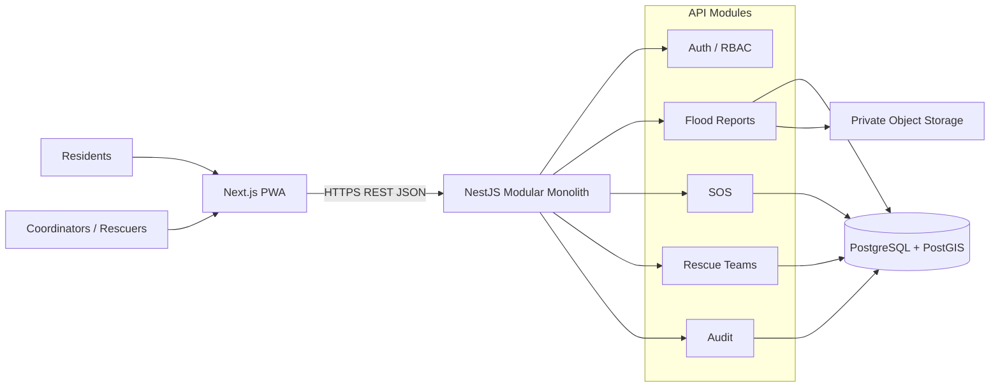

# Architecture overview

## Product and operating assumptions

FloodAid supports **community flood reports** and **private requests for rescue coordination** in one Thai district during a controlled MVP pilot. User groups: anonymous resident, rescuer, coordinator, admin. Anonymous public submissions do not imply trust or verified factual correctness.

**Hard boundary:** public map data never contains private SOS coordinates, contact information, vulnerabilities, notes, tracking tokens or rescue movements. Public flood report coordinates may identify reporters' homes; show only relevant flood-location data, apply privacy safeguards, and never attach the reporter's identity to public results.

## Stack and rationale

| Concern | Choice | Why |
|---|---|---|
| Monorepo | pnpm workspaces | Small solo-dev maintenance overhead |
| Frontend | Next.js App Router, React, TypeScript strict, Tailwind | Mobile-first PWA and admin console |
| Maps | MapLibre GL JS | Map markers/layers/GeoJSON; choose an approved licensed tile provider |
| Backend | NestJS modular monolith | Feature-based modules, dependency injection, DTO validation |
| API | REST `/api/v1`, Swagger/OpenAPI | Explicit testable contracts |
| ORM | TypeORM, migrations | Integration with NestJS; SQL freedom for spatial queries |
| Data | PostgreSQL 17 + PostGIS 3.5 | ACID state transitions and geospatial queries |
| Evidence | Private S3-compatible object storage | Media out of DB, controlled access |
| Local infra | Docker Compose DB; web/API on host | Easy debugging and fast hot reload |
| MVP refresh | Polling with sensible interval and visibility pause | Simple and reliable; no mandatory websockets |
| Deployment | Single region with managed backups and health checks | Fewer moving parts |

## Logical flow



## Boundaries / consistency

- **Public read:** flood reports with report/verification/age metadata. Public flood reports are not authoritative hazard warnings.
- **Restricted:** all SOS records and coordinates, team movements/assignments, sensitive evidence, contact data and audit records.
- SOS create, initial history and idempotency record must commit together; don't dispatch if persistence fails.
- Status transitions, actor and history commit atomically; assignments require concurrency control.
- Polling by clients is acceptable for MVP, but **staff notification coverage and manual monitoring** must be verified before real pilot.
- Avoid any claim that straight-line distance makes a route safe.

## Proposed repo layout

```text
floodaid/
├── AGENTS.md
├── docs/
│   ├── architecture/
│   ├── modules/
│   ├── development/
│   └── decisions/
├── apps/
│   ├── web/
│   │   ├── .env.example
│   │   └── src/{app,components,features,lib}
│   └── api/
│       ├── .env.example
│       └── src/{modules,common,database}
├── packages/contracts/src/
├── infra/
├── compose.yaml
├── pnpm-workspace.yaml
└── .env.example
```

Use `packages/contracts` only for transport-level shared types/enums, **not** TypeORM entities or server secrets. Prefer generated client types from OpenAPI when available.

## Out of scope

Kafka, Kubernetes, microservices, AI flood forecasting, automatic emergency priority decisions, verified safe route navigation, shelter occupancy, donations and IoT water sensors.
