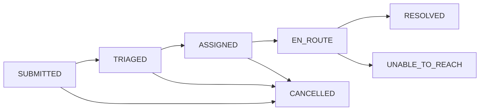

# Module: SOS Requests

**Status:** Planned · **Priority:** P0 after foundation · **Dependencies:** DB, audit trail, idempotency, operational response partner for real pilot

## Purpose and safety

Allow an anonymous resident to request help and privately track **acknowledged server receipt**. This is not an emergency dispatch guarantee. Never enable public real-event submission as an actively monitored channel without confirmed staffing, escalation and backup contact arrangements.

## In scope

- Anonymous create with location (GPS or manual), assistance type, people count, optional notes/contact channel.
- Generate strong random tracking token; store its hash; return token **once after commit**.
- Use `Idempotency-Key` to prevent logical duplicate cases on timeout/retry.
- Status viewer scoped to only one case; no public SOS listing/map.
- Staff priority triage (`UNASSESSED` by default), permitted status transitions and append-only history.
- Explicit frontend states: input, submitting, received, not confirmed, tracking.

## Lifecycle



Transitions to `UNABLE_TO_REACH` and `CANCELLED` must be explicitly authorized/audited; no automatic resolution. Additional transitions require a documented state-machine decision.

## Data model

`sos_requests`: UUID id, nullable requester ID, `tracking_token_hash char(64) unique`, `location geography(Point,4326)`, location accuracy, assistance type, people count (>0), priority, status, optional description, encrypted contact, timestamps. `sos_status_history`: id, sos_id, actor, old_status, new_status, reason, occurredAt. `idempotency_records`: key hash + canonical payload hash, stable case/result reference, TTL. SOS and related history/idempotency must commit atomically.

**Sensitive data:** exact coordinates, health/vulnerability details, contacts and private notes. Return minimal resident view, strictly scoped by token. Use staff permission checks for detailed view.

## API contract

| Method | Path | Access | Notes |
|---|---|---|---|
| POST | `/api/v1/sos` | Public + rate-limited | `Idempotency-Key` required; 201 |
| GET | `/api/v1/sos/:id` | Matching tracking token or authorized staff | Minimal resident status |
| PATCH | `/api/v1/admin/sos/:id/triage` | Coordinator/Admin | Priority + reason |
| PATCH | `/api/v1/admin/sos/:id/status` | Authorized staff | State transition + history |

Example POST body:

```json
{
  "location": {"latitude": 7.01, "longitude": 100.47, "accuracyMeters": 25},
  "assistanceType": "EVACUATION",
  "peopleCount": 4,
  "description": "Water is rising at my house"
}
```

Example response: `{ "id": "uuid", "status": "SUBMITTED", "createdAt": "ISO-8601", "trackingToken": "secret-once" }` (illustrative placeholders only). **Do not put token in route query/path, logs or telemetry.** Design secure recovery for token loss; no misleading guarantee of recoverability.

## Frontend

`/sos/new` step-by-step mobile UI, manual location fallback, prominent message about alternative verified emergency channels; `/sos/[id]` is just case identifier, not bearer credential; status fetch requires secret token provided securely. No public map SOS markers.

On network ambiguity, show: **"Submission not confirmed — check status or safely retry"**. Do not show success before the API commits. Display when the coordinator has acknowledged; do not imply responder dispatch until confirmed.

## Key engineering constraints

- Token hashing at rest, secure transport and redacted logs.
- Consistent idempotent retry behavior, including return/recovery of resident tracking credentials: design and test before launch, do not invent a new case on retry.
- Atomic state transition with actor and audit history; deny invalid or unauthorized changes.
- Abuse mitigation without preventing legitimate disaster requests, and configurable operational thresholds.
- Private PII retention/deletion and encryption key management agreed before pilot.

## Acceptance criteria

- [ ] Submit without login creates one case and initial history atomically.
- [ ] Same idempotency key + same payload does not create another case; changed payload conflicts.
- [ ] Unauthorized visitor cannot enumerate/read another resident's SOS.
- [ ] Public APIs and maps contain zero private SOS coordinates/contacts.
- [ ] GPS denial allows manual location.
- [ ] DB failure/timeout never results in misleading success UI.
- [ ] Transition rejects forbidden states, logs staff actor/reason and handles concurrent actions.
- [ ] Operational response partner/fallback verified before enabling live requests.
