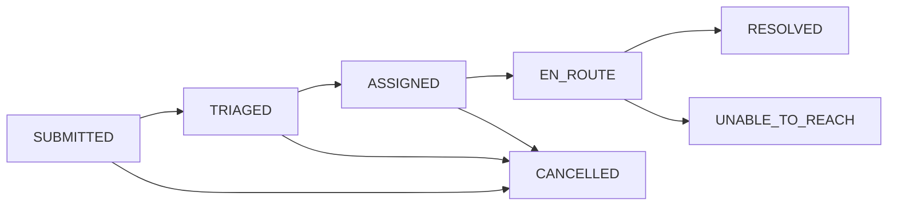

# Module: SOS Requests

**Status:** In progress · **Priority:** P0 after foundation · **Dependencies:** DB, audit trail, idempotency, operational response partner for real pilot

Sprint 2 implements submission and resident tracking for local simulation. Staff triage, assignments and live intake belong to later increments.

## Purpose and safety

Allow an anonymous resident to request help and privately track **acknowledged server receipt**. This is not an emergency dispatch guarantee. Never enable public real-event submission as an actively monitored channel without confirmed staffing, escalation and backup contact arrangements.

## In scope

- Anonymous create with location (GPS or manual), assistance type, people count, optional notes/contact channel.
- Return a private 256-bit tracking credential after commit. Store its hash and allow controlled recovery with the original submission credential.
- Use `Idempotency-Key` to prevent logical duplicate cases on timeout/retry.
- Status viewer scoped to only one case; no public SOS listing/map.
- Staff priority triage (`UNASSESSED` by default), permitted status transitions and append-only history.
- Explicit frontend states: input, submitting, received, not confirmed, tracking.

## Lifecycle



Transitions to `UNABLE_TO_REACH` and `CANCELLED` must be explicitly authorized/audited; no automatic resolution. Additional transitions require a documented state-machine decision.

## Data model

`sos_requests` stores the UUID, optional requester ID, SHA-256 tracking token digest, exact private PostGIS point, optional accuracy, assistance type, people count, status, priority and timestamps. Optional description and contact fields are stored as versioned AES-256-GCM ciphertext. `SOS_DATA_KEY` stays in the API environment. The cipher binds the case ID and field as authenticated data.

`sos_status_history` stores the initial `SUBMITTED` entry with reason `INTAKE_RECEIVED`. `idempotency_records` stores a key digest, a keyed canonical request fingerprint, a case reference and a receipt recovery expiry. The case, initial history and reservation commit in one transaction.

**Sensitive data:** exact coordinates, health/vulnerability details, contacts and private notes. Return minimal resident view, strictly scoped by token. Use staff permission checks for detailed view.

## API contract

| Method | Path | Access | Notes |
|---|---|---|---|
| GET | `/api/v1/sos/intake` | Public | Reports whether local simulation intake is enabled |
| POST | `/api/v1/sos` | Local simulation + rate-limited | `Idempotency-Key` required. `201` on create, `200` on exact authorized retry |
| GET | `/api/v1/sos/:id` | Matching tracking token | `{ id, status, createdAt, updatedAt }`. Missing case and invalid access return the same `404` |
| PATCH | `/api/v1/admin/sos/:id/triage` | Coordinator/Admin | Planned priority + reason |
| PATCH | `/api/v1/admin/sos/:id/status` | Authorized staff | Planned state transition + history |

Example POST body:

```json
{
  "location": {"latitude": 7.01, "longitude": 100.47, "accuracyMeters": 25},
  "assistanceType": "EVACUATION",
  "peopleCount": 4,
  "description": "Water is rising at my house"
}
```

Example response: `{ "id": "uuid", "status": "SUBMITTED", "createdAt": "ISO-8601", "trackingToken": "<private-credential>" }` (illustrative placeholders). The client generates `Idempotency-Key` as 32 cryptographically random bytes encoded as unpadded base64url. Treat this header and the tracking token as secrets and keep both out of URLs, logs and telemetry. GET uses `Authorization: Bearer <trackingToken>`. SOS responses set `Cache-Control: no-store`.

The server derives the tracking credential with domain-separated HMAC-SHA256 over a server-generated case ID, using the raw idempotency credential as the key. The database stores digests only. A retry with the same key and normalized body recovers the same receipt for 24 hours. Changed fields return `409`. After the window, an exact retry returns `410`; the reservation remains for the case lifetime to prevent another case from being created. A saved tracking token remains valid independently of the receipt recovery window.

## Frontend

`/sos/new` supports GPS, a bundled map pin and manual coordinates. The bundled map keeps the private viewport away from external tile providers. `/sos` prompts for a case ID and credential, and `/sos/[id]` prompts for the credential with the case ID prefilled. SOS stays separate from the public map.

On network ambiguity, the form keeps the same draft and credential in memory and asks the resident to retry it. Closing the page loses the draft and recovery credential. The receipt lets the resident save the case ID and private tracking credential manually. `SUBMITTED` confirms server persistence. The local simulation has no staffed response. For real events in Thailand, the UI shows public channels for disaster reporting and emergency medical care. [DDPM 1784](https://www.disaster.go.th/upload/special_orders/file_attach/50516/e40084a1c911addf8a36b6058c123cdc.pdf) · [NIEMS 1669](https://www.niems.go.th/1/Upload/migrate/File/255812251017320261_egZpFgOg91VlmqRP.pdf)

## Key engineering constraints

- Intake defaults to disabled. Enabling simulation requires a valid data key, a loopback API connection and host, and a local web origin. Forwarded intake requests are denied. Use synthetic information for simulation.
- The simulation allows 12 POST attempts per API instance every ten minutes by default. Request validation bounds accuracy to 0–100,000 meters, people to 1–1,000, description to 500 characters and contact to 120 characters.
- Atomic state transition with actor and audit history; deny invalid or unauthorized changes.
- Abuse mitigation without preventing legitimate disaster requests, and configurable operational thresholds.
- Private PII retention/deletion and encryption key management agreed before pilot.

## Acceptance criteria

- [x] Submit without login creates one case and initial history atomically.
- [x] An identical retry returns the same case. A different payload with the same key returns a conflict.
- [x] Private status requires the matching tracking credential.
- [x] Public flood endpoints and maps exclude private SOS coordinates and contacts.
- [x] GPS denial allows manual location.
- [x] Database failure rolls back the submission. A lost response shows an unconfirmed state until a receipt is retrieved.
- [ ] Transition rejects forbidden states, logs staff actor/reason and handles concurrent actions.
- [ ] Operational response partner/fallback verified before enabling live requests.
