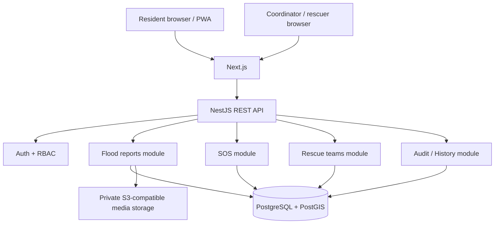
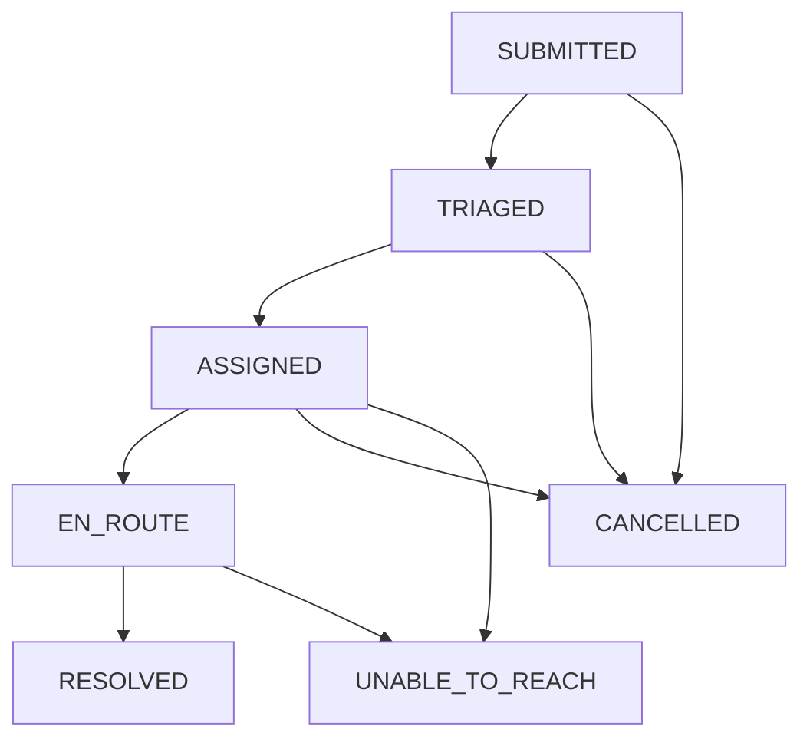

# FloodAid — Flood Response Platform

> **Project status:** Proposed MVP specification (not an operational emergency service)  
> **Version:** 1.0 | **Language:** English | **Primary deployment context:** Thailand  
> **Target:** Solo developer; controlled pilot in one district, with a real response partner before public launch.

## 1. Product overview

FloodAid is a mobile-first web platform that helps residents **report flooding**, **view time-stamped community reports**, **request assistance (SOS)**, and helps authorized coordinators **triage, assign, and track rescue work**.

### Objectives
1. Make it easy to report flood conditions with geolocation and evidence.
2. Show useful location-based information without mistaking an unverified report for an official warning.
3. Allow people to submit and track an SOS request without creating an account.
4. Provide a secure coordinator workflow from submission through resolution.
5. Operate with clear limitations, privacy controls, monitoring, and a manual emergency fallback.

### Out of scope for MVP
- AI flood forecasting, water-depth estimation from photographs, automated rescue prioritization, and automated safe-route recommendations.
- Donation inventory, shelter occupancy management, volunteer marketplace, IoT monitoring, Kafka, Kubernetes, and microservices.
- Claims of official flood warnings, guaranteed dispatch, or guaranteed emergency response.

### Non-negotiable launch requirement
Do not enable a public-facing SOS service as a live rescue channel until a named organization or coordinating group has agreed to monitor and respond to incoming cases, including after-hours coverage, escalation procedures, and a verified alternate emergency contact channel. A successfully submitted request means **received by the system**, not **accepted by a rescue team**.

## 2. Users and permissions

| Actor | Authentication | Allowed actions |
|---|---|---|
| Resident / anonymous visitor | No account needed | View public flood reports; submit flood report; submit SOS; track own SOS using secret token |
| Rescuer | Staff account | View assigned cases, accept/decline assignment, update authorized assignment progress |
| Coordinator | Staff account | Review submissions, triage SOS, assign teams, update case status, verify flood reports |
| Admin | Staff account | Manage staff and teams, configuration, audit access |

**Privacy:** Never expose SOS coordinates, contact details, or sensitive notes on public map endpoints. Require server-side authorization on every staff API route. Restrict access by role and assignment, not merely by whether a user is logged in.

## 3. MVP feature modules

### 3.1 Flood Reports
- Anonymous submission: location, observation timestamp, severity, road passability, optional description and photo.
- Public map listing by bounding box and age window; marker details include timestamp, source and verification status.
- Coordinator verification: `UNVERIFIED`, `VERIFIED`, `REJECTED` with evidence-based audit history.
- Limit input size, sanitize user content, rate-limit submissions, remove image metadata where appropriate, and prevent spam/duplicates.
- Road passability is user-reported, **not** a certified routing decision.

### 3.2 SOS Requests
- Minimal anonymous submission: location, assistance type, number of people, optional note, optional contact channel, and GPS accuracy.
- Support manual map-pin/location entry when GPS permission is denied or inaccurate.
- Generate a high-entropy tracking token; store only its hash, return token once over TLS; do not log it or place it in public URLs.
- Allow token holder to view only minimal status and acknowledgment details for their own case.
- Preserve a client-generated `Idempotency-Key` across retries and enforce deduplication server-side.
- Show explicit submission state: submitting, **received by server**, or **not confirmed**; never imply a rescue team is on its way without assignment confirmation.
- Allow cancellation through an authenticated/tracking-token-protected workflow with an auditable reason.

### 3.3 Coordinator Console
- Staff login, role-based access control (RBAC), and audit trail.
- SOS queue filterable by status, creation time, priority, assistance type, and map area.
- Manually triage priority. Default is `UNASSESSED`; do not infer clinical severity from a simplistic score.
- Assign to an eligible team, review acceptance/decline, change status with allowed state transitions.
- Surface unacknowledged cases and operational alerts; provide a manual fallback process.

### 3.4 Rescue Teams
- Manage team name, availability (`AVAILABLE`, `BUSY`, `OFFLINE`), members, capabilities and equipment notes.
- Assign/reassign teams. Prevent conflicting active assignments using transactions, locking, and database constraints.
- Do not select a team solely by straight-line distance; road closures and actual readiness matter.

## 4. Technology stack

| Layer | Choice | Notes |
|---|---|---|
| Repository | pnpm workspaces monorepo | `apps/web`, `apps/api`, `packages/contracts` |
| Language | TypeScript | Strict mode across repo |
| Web | Next.js App Router + React | Server components by default; client components for geolocation/map/forms |
| Styling | Tailwind CSS | Accessible, mobile-first UI |
| API | NestJS | REST under `/api/v1`, Swagger/OpenAPI |
| Validation | class-validator / class-transformer | NestJS global `ValidationPipe` |
| ORM | TypeORM | Explicit migrations; no production `synchronize` |
| Database | PostgreSQL 17 + PostGIS 3.5 | Geospatial indexes, transactions, constraints |
| Map | MapLibre GL JS | GeoJSON/map tiles from a licensed provider; no reliance on demo tiles |
| File storage | S3-compatible private bucket | Signed upload/read access; optional photos |
| Auth | Staff session or short-lived JWT + secure refresh | HttpOnly Secure cookies preferred for browser-based staff app |
| Observability | Structured logs, health checks, error tracking | Redact personal data and secrets |
| Dev infrastructure | Docker Compose | DB in Docker; app processes local for hot reload |
| CI | GitHub Actions or equivalent | lint, type-check, tests, migration validation |

**MVP real-time model:** REST polling (e.g., 15–30 seconds for staff dashboard) with time stamps; WebSocket and Redis may be introduced later. Avoid Kafka/microservices in MVP.

## 5. Architecture



**Architecture decision:** A modular monolith supports fast iteration, straightforward DB transactions, and low operational burden. Keep modules independent through service interfaces and avoid direct controller-to-repository access across modules.

## 6. Repository structure

```text
floodaid/
├── AGENTS.md
├── docs/
│   └── PROJECT_BLUEPRINT.md
├── apps/
│   ├── web/
│   │   ├── src/app/
│   │   │   ├── (public)/
│   │   │   │   ├── page.tsx
│   │   │   │   ├── map/page.tsx
│   │   │   │   ├── report/new/page.tsx
│   │   │   │   ├── sos/new/page.tsx
│   │   │   │   └── sos/[id]/page.tsx
│   │   │   └── (admin)/admin/
│   │   │       ├── layout.tsx
│   │   │       ├── page.tsx
│   │   │       ├── sos/page.tsx
│   │   │       ├── sos/[id]/page.tsx
│   │   │       └── rescue-teams/page.tsx
│   │   ├── src/features/{flood-reports,sos,admin,auth,map}/
│   │   ├── src/components/
│   │   └── src/lib/
│   └── api/
│       ├── src/modules/{auth,flood-reports,sos,rescue-teams,audit}/
│       ├── src/common/{guards,decorators,filters}/
│       ├── src/database/{migrations,data-source.ts}
│       ├── src/app.module.ts
│       └── src/main.ts
├── packages/contracts/src/
├── infra/docker/
├── compose.yaml
├── .env.example
└── pnpm-workspace.yaml
```

**Shared package policy:** `packages/contracts` should contain small API types/enums and generated clients/contracts as needed; never share TypeORM entities or server secrets with the web app. Prefer OpenAPI-generated client models to hand-maintained duplicates.

## 7. Data model

### 7.1 Core tables

| Table | Purpose | Key fields |
|---|---|---|
| `users` | Staff identities | `id`, `name`, `email` unique, `password_hash` or external identity reference, `role`, `created_at` |
| `flood_reports` | Geo-tagged community observations | `id`, nullable `reporter_id`, `location`, `severity`, `road_status`, `verification_status`, `description`, `observed_at`, `created_at` |
| `report_evidence` | Uploaded images | `id`, `report_id`, `storage_key`, `media_type`, `created_at` |
| `sos_requests` | Requests requiring coordination | `id`, nullable `requester_id`, `tracking_token_hash` unique, `location`, `location_accuracy_m`, `assistance_type`, `people_count`, `priority`, `status`, `description`, optional encrypted contact, `created_at`, `updated_at` |
| `sos_status_history` | Immutable case transitions | `id`, `sos_id`, nullable `changed_by`, `old_status`, `new_status`, `reason`, `created_at` |
| `rescue_teams` | Responder teams | `id`, `name`, `status`, optional `base_location`, `capabilities`, `created_at` |
| `team_members` | Team-member links | composite PK `(team_id, user_id)` |
| `rescue_assignments` | Team-to-case assignments | `id`, `sos_id`, `team_id`, `status`, `assigned_at`, `completed_at` |

### 7.2 Supporting tables recommended before live pilot
- `audit_logs`: actor, action, target, timestamp, minimal redacted change metadata.
- `idempotency_keys`: scoped key, request fingerprint, immutable response reference, expiry; enforce uniqueness atomically.
- `notification_outbox`: durable notifications and retry state (especially if no external queue service yet).
- `flood_report_verifications`: verifier, decision, time and reason (if verification history is required beyond one current-state field).

### 7.3 Controlled enums

```typescript
export type FloodSeverity = 'LOW' | 'MODERATE' | 'HIGH' | 'CRITICAL';
export type RoadStatus = 'UNKNOWN' | 'PASSABLE' | 'IMPASSABLE';
export type VerificationStatus = 'UNVERIFIED' | 'VERIFIED' | 'REJECTED';
export type AssistanceType = 'EVACUATION' | 'FOOD' | 'WATER' | 'MEDICAL';
export type SosPriority = 'UNASSESSED' | 'LOW' | 'MEDIUM' | 'HIGH' | 'CRITICAL';
export type SosStatus = 'SUBMITTED' | 'TRIAGED' | 'ASSIGNED' | 'EN_ROUTE' | 'RESOLVED' | 'CANCELLED' | 'UNABLE_TO_REACH';
export type TeamStatus = 'AVAILABLE' | 'BUSY' | 'OFFLINE';
export type AssignmentStatus = 'ASSIGNED' | 'ACCEPTED' | 'DECLINED' | 'COMPLETED' | 'CANCELLED';
export type StaffRole = 'ADMIN' | 'COORDINATOR' | 'RESCUER';
```

### 7.4 PostGIS rules
- Store geospatial points as `geography(Point, 4326)` and create GiST indexes on location fields.
- `ST_MakePoint(longitude, latitude)`: **longitude first**.
- For a public map query, validate the bbox before constructing `ST_MakeEnvelope(minLng, minLat, maxLng, maxLat, 4326)`; cap geographic extent and number of returned rows.
- `ST_DWithin(geography, geography, radiusMeters)` uses meters.
- Return `ST_AsGeoJSON(location::geometry)::json` for public flood map features; **never return raw SOS location publicly**.
- Always include `observed_at`, `created_at`, verification state, and data age/staleness indicators.

Example index and radius search:

```sql
CREATE EXTENSION IF NOT EXISTS postgis;
CREATE INDEX idx_flood_reports_location ON flood_reports USING GIST (location);

SELECT id, severity, observed_at
FROM flood_reports
WHERE ST_DWithin(
  location,
  ST_SetSRID(ST_MakePoint(100.50, 13.75), 4326)::geography,
  2000
)
ORDER BY observed_at DESC
LIMIT 100;
```

Migration conventions:
- Schema changes through version-controlled TypeORM migrations only.
- Keep indexes and check constraints in migrations.
- Wrap state updates and history insertion in the same DB transaction.
- Prefer UUID primary keys with `gen_random_uuid()`.
- Define `ON DELETE` behavior explicitly; do not cascade-delete SOS history.
- For one active assignment **per SOS** (if chosen for MVP), use an appropriate partial unique index on `sos_id`; a unique `(sos_id, team_id)` only prevents duplicate assignments to the *same* team, not multiple teams.

## 8. REST API contract

Base URL: `/api/v1`. API responses use camelCase JSON; DB columns use snake_case.

| Method | Path | Access | Description |
|---|---|---|---|
| `GET` | `/health` | Public | Health and readiness (no sensitive internals) |
| `GET` | `/flood-reports?bbox=...&since=...` | Public | Paginated/capped map reports (GeoJSON or API objects) |
| `GET` | `/flood-reports/:id` | Public | Report details, redacted |
| `POST` | `/flood-reports` | Public, rate-limited | Submit report |
| `POST` | `/sos` | Public, rate-limited | Submit SOS with `Idempotency-Key` |
| `GET` | `/sos/:id` | Valid tracking token or permitted staff | Minimal request status |
| `POST` | `/auth/login` | Staff | Authenticate staff |
| `POST` | `/auth/logout` | Staff | End staff session |
| `GET` | `/admin/sos` | Coordinator/Admin | Paginated SOS queue |
| `GET` | `/admin/sos/:id` | Authorized staff | Private case details |
| `PATCH` | `/admin/sos/:id/triage` | Coordinator/Admin | Set priority, assessment reason |
| `PATCH` | `/admin/sos/:id/status` | Authorized staff | Validated status transition |
| `POST` | `/admin/sos/:id/assignments` | Coordinator/Admin | Assign team atomically |
| `GET` | `/admin/rescue-teams` | Authorized staff | Teams and availability |
| `POST` | `/admin/rescue-teams` | Admin | Create a team |
| `PATCH` | `/admin/rescue-teams/:id` | Admin | Update team details/capabilities |
| `POST` | `/admin/flood-reports/:id/verification` | Coordinator/Admin | Verify/reject report |

### 8.1 Example: create SOS

Request `POST /api/v1/sos`:

```http
Content-Type: application/json
Idempotency-Key: 3d2db2ee-0a8e-421a-8561-b2b4b4de729f
```

```json
{
  "location": { "latitude": 13.75, "longitude": 100.50, "accuracyMeters": 15 },
  "assistanceType": "EVACUATION",
  "peopleCount": 4,
  "description": "Water rising inside the house; elderly resident present."
}
```

Response `201 Created`:

```json
{
  "id": "8a44e047-f6df-45b2-a43b-54d28015e23a",
  "status": "SUBMITTED",
  "createdAt": "2026-11-18T08:00:00.000Z",
  "trackingToken": "<returned-once-secret>"
}
```

This acknowledges **storage**, not dispatch. On retry with the same idempotency key and identical payload, return the same logical case and recovery-safe tracking access according to a documented retention strategy; do not mint an unrelated SOS. Never persist raw tracking tokens in logs or plaintext DB fields.

### 8.2 Error convention

```json
{
  "statusCode": 400,
  "code": "VALIDATION_ERROR",
  "message": "Invalid location",
  "requestId": "req_..."
}
```

Avoid exposing stack traces or PII in responses. Return appropriate 401/403/404/409/422/429/5xx semantics. For ambiguous network errors, UI must say **submission not confirmed**, not **failed**, unless the server explicitly rejected it.

### 8.3 Core controller/service conventions
- Controllers handle HTTP and validation; services enforce business rules; repositories/query services own database access.
- `ValidationPipe({ whitelist: true, forbidNonWhitelisted: true, transform: true })` globally.
- Use parameterized SQL whenever calling PostGIS functions directly.
- Generate Swagger/OpenAPI; ensure response DTOs intentionally omit private fields.
- Add authentication, RBAC guards, pagination bounds, request IDs, and structured audit logging.

## 9. SOS workflow and state machine



**Implementation notes:**
- Only authorized operators can transition staff-controlled states; requester may cancel through a secure separate path.
- Record old/new status, actor, reason and timestamp atomically.
- Reassignment, declined assignments and case reopening need explicit business rules before implementation; don't silently change state.
- Coordinator should see untriaged and aged requests prominently.
- Tracking status UI must distinguish `SUBMITTED` from `ASSIGNED` and `EN_ROUTE`.

## 10. Frontend pages and behavior

### Public
- `/` — home: search/view map, report flood, prominent SOS action, emergency disclaimer.
- `/map` — MapLibre map with bbox-driven flood report markers, severity legend, source/verification, observed time, stale indicator.
- `/report/new` — location selection (GPS or manual), severity, road passability, optional notes/photo, submit status.
- `/sos/new` — accessible high-priority form with minimal required fields; explicit consent notice for sensitive information; idempotent submission.
- `/sos/[id]` — tracking page with token-protected fetch and minimal public-facing status. Avoid embedding tracking token in URL.

### Staff
- `/admin` — summary counts, outstanding unassessed/aging requests, polling and last-refresh status.
- `/admin/sos` — filter/sort/paginate queue.
- `/admin/sos/[id]` — private details, history, triage, assignment and status actions.
- `/admin/rescue-teams` — teams, members, availability.

### Frontend implementation
- Next.js App Router + TypeScript + Tailwind CSS.
- Render maps and geolocation logic in client components; dynamically import MapLibre where required.
- Use `fetch`/a typed client; React Query is optional, not required for first vertical slice.
- Mobile-first; Thai language UI initially, keep i18n-ready copy organization.
- Accessible form labels, keyboard support, large touch targets, loading/empty/error states.
- No false success toast on unresolved network requests; retries reuse the original idempotency key.
- Poll coordinator queue at a bounded interval, with last-updated/connection state. Slow/down connections should not silently erase already entered user form data.

## 11. Docker and local development

For fast local iteration, run PostgreSQL/PostGIS in Docker and NestJS/Next.js on host.

`compose.yaml`:

```yaml
name: floodaid
services:
  postgres:
    image: postgis/postgis:17-3.5
    restart: unless-stopped
    environment:
      POSTGRES_USER: ${POSTGRES_USER}
      POSTGRES_PASSWORD: ${POSTGRES_PASSWORD}
      POSTGRES_DB: ${POSTGRES_DB}
    ports:
      - "127.0.0.1:5433:5432"
    volumes:
      - postgres_data:/var/lib/postgresql/data
    healthcheck:
      test: ["CMD-SHELL", "pg_isready -U \"$$POSTGRES_USER\" -d \"$$POSTGRES_DB\""]
      interval: 10s
      timeout: 5s
      retries: 5
volumes:
  postgres_data:
```

`.env.example`:

```dotenv
POSTGRES_USER=flood_app
POSTGRES_PASSWORD=change_me_for_local_development
POSTGRES_DB=floodaid
DATABASE_HOST=localhost
DATABASE_PORT=5433
DATABASE_USERNAME=flood_app
DATABASE_PASSWORD=change_me_for_local_development
DATABASE_NAME=floodaid
API_PORT=4000
NEXT_PUBLIC_API_URL=http://localhost:4000/api/v1
NEXT_PUBLIC_MAP_STYLE_URL=
```

**Note:** Verify platform architecture before pulling the image, particularly Apple Silicon (`arm64`); choose/build a compatible PostgreSQL + PostGIS image if needed rather than blindly relying on emulation. Never put production credentials in `.env.example`.

Expected commands after workspace scripts are defined:

```bash
corepack enable
pnpm install
docker compose up -d postgres
# Run project migrations after the API workspace and data source exist
pnpm --filter api migration:run
pnpm --filter api start:dev
# in a second terminal
pnpm --filter web dev
```

Local endpoints: web `http://localhost:3000`, API `http://localhost:4000/api/v1`, database `127.0.0.1:5433`.

## 12. Security, reliability and operational guardrails

### Security
- TLS everywhere outside local dev; secure session cookies; RBAC enforced server-side.
- Rate limits and bot mitigation with accessible alternatives; avoid locking out legitimate emergency reporters.
- Do not place SOS coordinates/contact info in public responses, analytics, map features or logs.
- Encrypt optional contact information at rest, keep keys out of the database, restrict access and set retention/deletion rules.
- Handle uploads using content-type/size validation, malware scanning where feasible, private object storage and safe signed URLs; strip photo EXIF/location metadata before public display.
- Audit all staff access and mutations of sensitive cases; redact secrets and personal details from logs.
- Provide a privacy notice, data retention policy and access-revocation procedures appropriate to Thailand's PDPA obligations; obtain legal review before broad deployment.

### Resilience
- Idempotent SOS creation; DB transaction for case + history; concurrency controls for dispatch.
- Outbox or durable delivery log for coordinator notifications; alert if SOS notification fails.
- Database backups with restoration drills; health checks and basic incident playbook.
- Never claim SOS receipt before DB commit. Distinguish `received by system` vs `reviewed` vs `assigned`.
- If offline, allow draft composition where safe but **do not** mark it sent; prominently show an alternative verified emergency channel.
- Separate simulated/test cases from production cases; do not allow test alerts into real rescue operations.

### Data integrity
- Source and observation timestamps for flood reports; stale data is visibly labeled.
- User-reported conditions must not masquerade as official warnings.
- Validate location accuracy and avoid using raw flood markers to infer certified safe roads.
- Avoid promising response times without a participating organization and measured operational capability.

## 13. Testing requirements

| Level | Scenarios |
|---|---|
| Unit | DTO validation, bbox validation, state transitions, permission checks, idempotency fingerprint |
| Integration | TypeORM migrations + PostGIS queries, DB transactions, duplicate keys, active assignment constraints |
| API e2e | Flood report, anonymous SOS, tracking-token authorization, staff authentication/RBAC |
| Frontend e2e | GPS denied/manual entry, form persistence, network uncertainty, submission receipt, accessible controls |
| Concurrency | Two coordinators assigning same case, double submit, repeated retry of same SOS |
| Security | No SOS PII on public routes; tokens absent from logs/URLs; unauthorized access rejected |
| Operations | Notification failures, DB outage behavior, monitoring alert, backup restoration, human escalation drill |

A controlled pilot requires explicit acceptance tests for cases received, noticed, assigned, escalated, and closed. Do not open a public SOS intake merely because automated tests pass.

## 14. Delivery roadmap (solo developer estimates)

| Phase | Goal | Exit criterion |
|---|---|---|
| Week 1 | Workspace, DB/PostGIS, migrations, API skeleton, Swagger, CI | Web connects to API; health and DB tests green |
| Week 2 | Flood report API + public map | Report flows into geospatial map, timestamp and verification state visible |
| Week 3 | Anonymous SOS + tracking + idempotency | Request created and retried safely; status visible privately |
| Week 4 | Staff auth + coordinator queue + triage | Operators can manage cases with audit history |
| Week 5 | Teams + assignment + notification fallback | End-to-end case workflow passes rehearsal |
| Week 6 | Security, tests, observability, backup drills, controlled pilot | Agreed operational partner and checklist signed off |

These are planning estimates, not a live-launch promise. Extend the plan if partner coordination, operational staffing, legal review or safety checks are incomplete.

## 15. Definition of done

- [ ] Anonymous users can view time-stamped flood reports on a map.
- [ ] Anonymous users can submit reports using GPS or manual position and see clear verification status.
- [ ] SOS is idempotent and reports **received** only after server commit.
- [ ] Requester can track only their own case using a secret credential.
- [ ] Staff role restrictions protect all private information and actions.
- [ ] Coordinators can triage, assign, update, audit and close cases.
- [ ] Public API never exposes sensitive SOS coordinates/contact details.
- [ ] Backups, restoration, monitoring, error handling and operational escalation are tested.
- [ ] A real coordinating organization has committed to intake and fallback before any live SOS pilot.

## 16. First vertical slice — implement this first

1. Bootstrap `pnpm` workspace with `apps/api` and `apps/web`.
2. Start PostgreSQL/PostGIS in Docker; create migration pipeline.
3. Implement `GET /api/v1/health` and Swagger.
4. Create `flood_reports` schema and `POST /flood-reports` (minimal validation).
5. Add bbox-filtered `GET /flood-reports` returning GeoJSON-compatible data.
6. Build `/report/new` and `/map` with MapLibre.
7. Add API + UI tests and make sure unverified/stale reports display correctly.
8. Only then implement SOS request flow and its security/operational safeguards.

## 17. Future extensions (not MVP)

- Verified third-party feeds from ThaiWater, GISTDA, or other official providers (subject to access and licensing).
- Shelter information and occupancy; donation and relief inventory.
- WebSocket for live coordinator updates; Redis caching; event outbox or Kafka where justified.
- Offline-safe PWA workflows with clear unsent markers.
- Responder capabilities and route-aware dispatch using genuinely verified route data.
- Historical analytics and carefully evaluated predictive models.

## 18. Open decisions to resolve before live deployment

1. Which district and which specific response organization will own the pilot queue?
2. What confirmed alternative emergency contacts and escalation hours should be shown?
3. Which map tile provider/license and image-storage vendor will be used?
4. Which staff authentication provider and password reset process will be used?
5. What SOS priority criteria, assignment ownership model, and escalation SLAs will the operating partner approve?
6. What retention/deletion intervals and PDPA notices are appropriate?
7. How will reports be verified and how will malicious/fake reports be handled?

**Guiding rule:** Build the smallest system that can reliably help a responsible human coordinator act on a real request. Do not automate life-critical judgments or promise rescue availability without verified operations.
